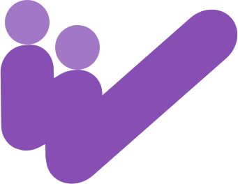

<h1 align="center">
  
  <br>WOOM<br>
</h1>

<div align="center">
    <a href="https://discord.gg/mtSpDNwCAz"></a>
    &nbsp;
    <a href="https://t.me/binbatlib"></a>
    &nbsp;
    <a href="https://twitter.com/binbatlab"></a>
</div>

---

A painless self-hosted Meeting service, use [Live777](https://github.com/binbat/live777) engine

## Run

Depends: Redis, Live777 service

```bash
docker compose up
```

WebApp:

```bash
npm install
npm run dev
```

Server:

```bash
go run .
```


## Release build

```bash
make
```

## E2E test

Browser automation tests with [Playwright](https://playwright.dev), covering the
core meeting flows (create/join/hang up, two-party audio/video over WHIP/WHEP),
inspired by the [Live777](https://github.com/binbat/live777) browser tests.

Depends: Redis, Live777 service

```bash
docker compose up -d
npx playwright install chromium
npm run test:e2e
```

`npm run test:e2e` builds the WebApp and the release server binary, then runs the
tests against it. Once built, iterate with `npx playwright test` (reuses a server
already listening on :4000).

